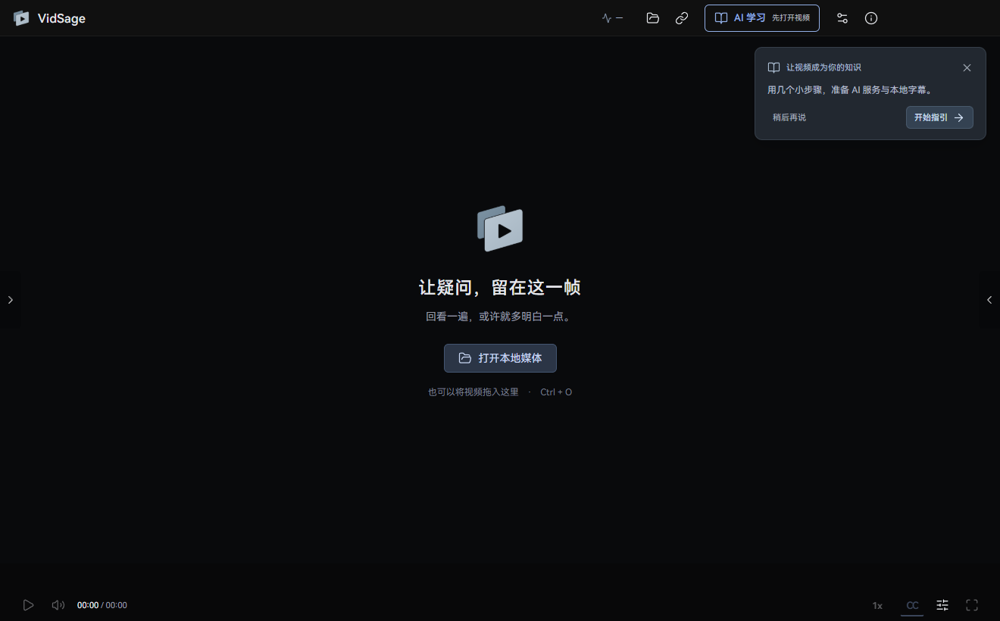
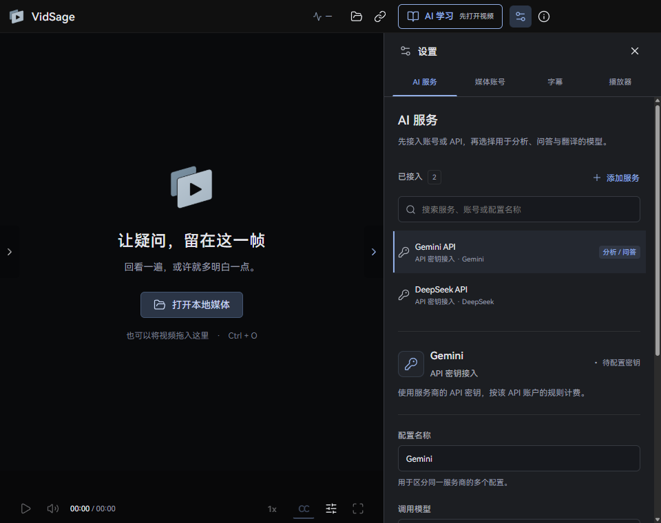

<h1 align="center">VidSage</h1>

<strong>Watch, understand, and return to the source.</strong> A video learning player with subtitles, notes, and AI analysis beside the video.

<a href="README.md"><strong>简体中文</strong></a> · <strong>English</strong>

  

<a href="docs/GETTING_STARTED.en.md">Get started</a> · <a href="docs/HARDWARE.en.md">Hardware & models</a> · <a href="docs/FEEDBACK.en.md">Report a problem</a> · <a href="docs/PRIVACY.md">Privacy</a>

> **The 0.1.80 public preview is available.** Get the complete installer, SHA256 checksums, and corresponding third-party source materials from the [GitHub Release](https://github.com/Elviszhuoyu/VidSage-Releases/releases/tag/v0.1.80). This preview is unsigned; verify the source and checksum before installation. The existing screenshots show 0.1.77.

The app currently has a **Simplified Chinese interface**. English documentation is available; an English interface is planned for a later version.

## Why I built VidSage

I started working on it while studying finance and other subjects through video courses. Often, the video had moved on while I was still trying to understand the previous idea.

AI helped me break difficult concepts into smaller pieces, ask for another explanation, and check it against the video. But switching between web pages, extensions, and notes kept interrupting my thinking. I wanted a desktop tool I would enjoy using, with the video, subtitles, questions, and notes together. It should work for a course saved on my computer as well as supported videos on Bilibili and YouTube.

That is where VidSage began. I hope it makes learning a little easier for you, too.

## A workspace for understanding video

- Use platform subtitles, import a subtitle file, or generate captions locally.
- Analyze and ask questions about subtitles, then return to the video through timestamps.
- Save notes and analysis as material you can revisit and search.
- Choose an API, ChatGPT cloud authorization, or a supported local service. Media sign-in is optional; local playback needs no AI account.

The home screen starts clear. An optional four-step guide helps prepare services and subtitles. Settings use four categories: AI services, Media accounts, Subtitles, and Player.

## Will it work on my computer?

This release targets **Windows 11 x64** and includes the Whisper **base** model and GPU acceleration runtimes. Auto prefers a compatible NVIDIA GPU. A recognized GPU failure during loading or the first computation before confirmed captions triggers one CPU attempt with a visible reason. GPU and CPU can also be selected manually. AMD and integrated-graphics users can use CPU. GPU/CPU were verified on one RTX 4090 computer; other devices remain part of public testing.

| What you want to do | Where to start |
|---|---|
| Watch video and read existing subtitles | Open media; no AI account required |
| Generate local captions | Start with the bundled base model; small and large-v3-turbo are optional |
| Analyze, ask questions, or translate | Configure your chosen service and review costs and data sharing |
| Check hardware suitability | Read the [hardware and model guide](docs/HARDWARE.en.md), then try a short video |

Allow at least 6 GB for installation and temporary extraction. Model file size is not a RAM requirement. A minimum RAM specification and general transcription-speed guarantees have not been validated.

## Installation and updates

Obtain the complete Setup from the [0.1.80 Release](https://github.com/Elviszhuoyu/VidSage-Releases/releases/tag/v0.1.80) and verify its SHA256. The first preview is unsigned. Windows may show an unknown-publisher or security warning, and some device policies may prevent execution. Verify the source first; stop if you encounter an unexpected or malware warning. Do not disable system protection.

The installer includes the player, core, local caption runtime, and base model; no development environment is required. Updates use a full Setup after closing the player. Standard Windows uninstall is available; updates and uninstall preserve personal data by default. About → Updates and installation checks this repository for public previews. Updates download a full Setup; live patching is not provided.

[Installation, checksums, and the first four steps →](docs/GETTING_STARTED.en.md)

## Privacy and feedback

Local captions stay on your computer. Authorized cloud analysis, questions, and translation send subtitles and necessary context to the selected provider. ChatGPT sign-in connects to a cloud service; it does not establish transcription-API access through your subscription.

Limited runtime logs stay local; the first preview does not upload them automatically. Export a diagnostic ZIP through **关于 → 报告问题 (About → Report a problem)** after reviewing its contents, then choose whether to submit it. **GitHub Issues are public. Image content and metadata are not automatically redacted.**

[How to describe, review, and submit a report →](docs/FEEDBACK.en.md) · [Privacy statement](docs/PRIVACY.md)

## Support the author

If VidSage has helped you, you are welcome to buy me a coffee. Any amount is appreciated. Donations are optional and do not affect features.

<table>
<tr><td align="center"><strong>微信支付 · WeChat Pay</strong></td><td align="center"><strong>支付宝 · Alipay</strong></td></tr>
<tr><td align="center"></td><td align="center"></td></tr>
</table>

These codes are also available in **关于 → 支持作者 (About → Support the author)**. A donation does not grant development or redistribution permission.

## Use and permissions

**Rights in original code are reserved; further development requires the author's prior written permission.** Officially released test builds may be evaluated free of charge. Application source and development history remain private. GitHub platform rights and third-party licenses apply separately. See the [use and copyright notice](COPYRIGHT.md).

Recognition, translation, and analysis can be wrong, especially with names and numbers. Check important details against the video, and use only content you are entitled to access and process.
