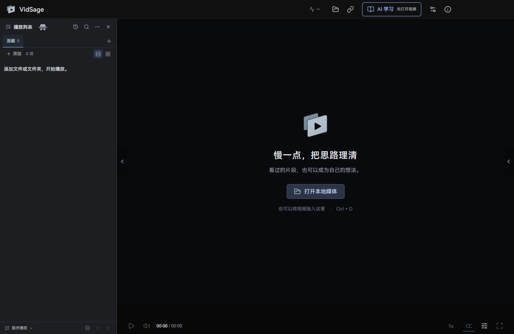
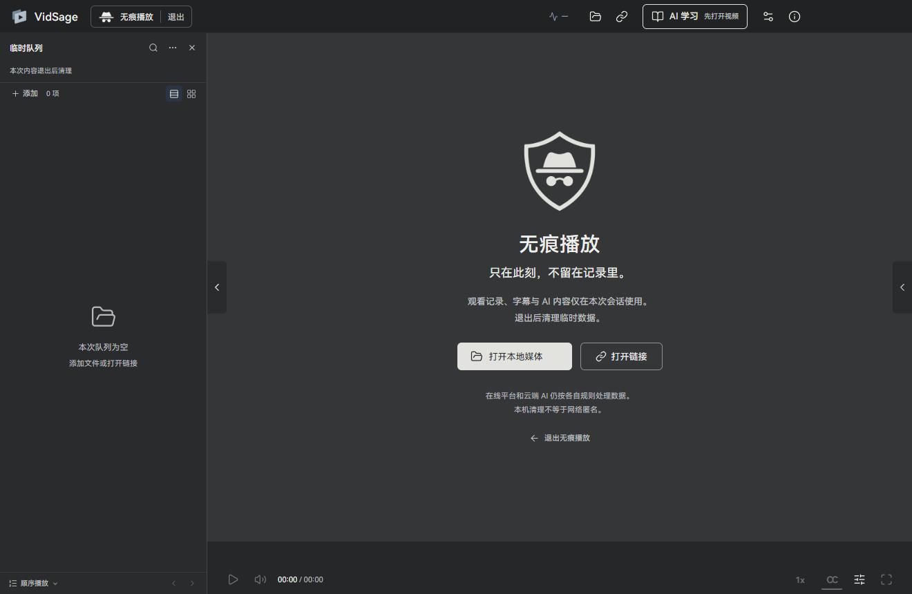

<h1 align="center">VidSage</h1>

<strong>Watch, understand, and return to the source.</strong> A local-first Windows AI video player with Whisper transcription, video summaries, timestamped Q&A and notes.

<a href="README.md"><strong>简体中文</strong></a> · <strong>English</strong>

  

<a href="docs/GETTING_STARTED.en.md">Get started</a> · <a href="docs/HARDWARE.en.md">Hardware & models</a> · <a href="docs/FEEDBACK.en.md">Report a problem</a> · <a href="docs/PRIVACY.md">Privacy</a>

The app provides **Simplified Chinese and English interfaces**. Switch the interface language in Settings → Player. Caption and AI output languages are configured separately.

> **0.2.1 public preview.** [Full installer](https://github.com/Elviszhuoyu/VidSage-Releases/releases/download/v0.2.1/VidSage-0.2.1-win11-x64-Setup.exe) · [Release notes](docs/RELEASE_0.2.1.md#english) · [Downloads and mirrors](docs/DOWNLOADS.md#english)

## One place to watch, understand and keep what matters

- Ask about a caption, chapter or whole video, then jump to the original timestamp.
- Choose from seven analysis modes for narrated courses, tutorials and everyday videos, beyond finance alone.
- Use platform captions, import SRT/VTT, or transcribe locally with the bundled base model; correct, translate and export caption tracks.
- Keep timestamped notes, analysis and Q&A in a searchable local library.
- Choose ChatGPT subscription authorization, supported APIs or compatible local services. Confirm the cloud processing scope yourself.
- Use an independent private session for temporary viewing.

0.2.1 adds per-model usage and CNY estimates, activity charts, bounded public comment analysis, Chinese/English UI, quality choices and playback statistics. Long-video processing has less repeated input and visible progress; model readiness and sidebar dragging are clearer. Compatible content updates reuse verified installed files.

A local 112-minute sample improved from about 7m34s to 4m24s with about 17% fewer input tokens. Speed and usage vary. This is a public preview; check important caption and AI results against the original video.

## Why I built VidSage

I started working on it while studying finance and other subjects through video courses. Often, the video had moved on while I was still trying to understand the previous idea.

AI helped me break difficult concepts into smaller pieces, ask for another explanation, and check it against the video. But switching between web pages, extensions, and notes kept interrupting my thinking. I wanted a desktop tool I would enjoy using, with the video, subtitles, questions, and notes together. It should work for a course saved on my computer as well as supported videos on Bilibili and YouTube.

That is where VidSage began. I hope it makes learning a little easier for you, too.

## Private playback for temporary viewing

Start from the hat-and-glasses icon beside the playlist heading. Your ordinary queue stays intact. The temporary session has its own queue, platform sign-in, and ChatGPT sign-in, with a persistent status and exit control beside the product name.

Subtitles, analysis, questions, and temporary notes stay within that session, outside ordinary history and the knowledge library. Exiting ends the session process and clears temporary data before returning to ordinary playback. A graphite interface and soft transition identify the mode; reduced-motion settings are respected.

Private playback may write to a dedicated temporary directory. It does not guarantee forensic erasure or network anonymity. Online platforms and cloud AI services retain their own data practices. See [Privacy](docs/PRIVACY.md).

## A workspace for understanding video

- Use platform subtitles, import a subtitle file, or generate captions locally.
- Analyze and ask questions about subtitles, then return to the video through timestamps.
- Save notes and analysis as material you can revisit and search.
- Choose an API, ChatGPT cloud authorization, or a supported local service. Media sign-in is optional; local playback needs no AI account.

Long-form and financial recaps preserve thematic reasoning, evidence, and conditions alongside chapter navigation. Action lists include observable completion criteria. Knowledge breakdown separates video interpretation, concept explanations, and hypothetical examples, retaining explanations and limitations. Whole-video questions can follow up on the current report. The AI report is not video evidence; answers retain subtitle references that return to the video.

An optional six-step guide helps you start. Settings cover AI services, Media accounts, Subtitles, Player, and Storage. Qwen models and their environment are optional and prepared separately from the standard installer.

## Will it work on my computer?

Current builds target **Windows 11 x64 with x86-64-v3 CPU support (including AVX2)**. The complete package includes the Whisper **base** model. Captions can run on CPU, including computers with AMD graphics or integrated graphics. GPU acceleration requires a compatible environment; independent GPU setups have not yet been validated for this candidate.

| What you want to do | Where to start |
|---|---|
| Watch video and read existing subtitles | Open media; no AI account required |
| Generate local captions | Start with the bundled base model; small and large-v3-turbo are optional |
| Analyze, ask questions, or translate | Configure your chosen service and review costs and data sharing |
| Check hardware suitability | Read the [hardware and model guide](docs/HARDWARE.en.md), then try a short video |

Allow at least 6 GB for installation and temporary extraction. Model file size is not a RAM requirement. A minimum RAM specification and general transcription-speed guarantees have not been validated.

## Installation and updates

Obtain the complete Setup from the [official releases page](https://github.com/Elviszhuoyu/VidSage-Releases/releases). SHA256 verification is available if you want to check the downloaded file. The first preview is unsigned. Windows may show an unknown-publisher or security warning, and some device policies may prevent execution. Verify the source first; stop if you encounter an unexpected or malware warning. Do not disable system protection.

The standard installer includes the player, core, local caption runtime, and base model; no development environment is required. Qwen models and their environment are separate options. New versions can check for updates, download a complete Setup, and ask you to confirm installation through About. Older versions can upgrade by downloading and running Setup. Updates preserve your data. Interactive uninstall offers separate cache, default-model and personal-data choices, all unchecked by default. Custom folders and exported files stay untouched. Reinstalling over leftover Python bytecode no longer blocks setup.

[Installation, checksums, and getting started →](docs/GETTING_STARTED.en.md)

## AI services and free-tier limits

The Gemini API free tier can have model, region, request-rate and daily quota limits. During development we encountered **503 unavailability, incomplete output for long content, and answers or references that needed source review**. A successful connection check does not guarantee a successful generation.

Other APIs and ChatGPT subscriptions have their own limits too. VidSage does not automatically switch to a paid service. Keep watching the original, retry when ready, or choose another service yourself. Local playback, existing subtitles and notes do not require cloud AI.

## Privacy and feedback

Local captions stay on your computer. Authorized cloud analysis, questions, and translation send subtitles and necessary context to the selected provider. ChatGPT sign-in connects to a cloud service; it does not establish transcription-API access through your subscription.

Limited runtime logs stay local; the first preview does not upload them automatically. Export a diagnostic ZIP through **关于 → 报告问题 (About → Report a problem)** after reviewing its contents, then choose whether to submit it. **GitHub Issues are public. Image content and metadata are not automatically redacted.**

[How to describe, review, and submit a report →](docs/FEEDBACK.en.md) · [Privacy statement](docs/PRIVACY.md)

## Support the author

If VidSage has helped you, you are welcome to buy me a coffee. Any amount is appreciated. Donations are optional and do not affect features.

<table>
<tr><td align="center"><strong>微信支付 · WeChat Pay</strong></td><td align="center"><strong>支付宝 · Alipay</strong></td></tr>
<tr><td align="center"></td><td align="center"></td></tr>
</table>

These codes are also available in **关于 → 支持作者 (About → Support the author)**. A donation does not grant development or redistribution permission.

## Use and permissions

VidSage is independently maintained by Zhuoyu. Portions of its code and default prompts are adapted from the [open-source project by moonjoin](https://github.com/moonjoin/tampermonkey-scripts), used under MIT. See the full [license](licenses/upstream/moonjoin/LICENSE.txt) and [source notice](licenses/upstream/moonjoin/NOTICE.md).

**Rights in original code are reserved; further development requires the author's prior written permission.** Officially released test builds may be evaluated free of charge. Application source and development history remain private. GitHub platform rights and third-party licenses apply separately. See the [use and copyright notice](COPYRIGHT.md).

Recognition, translation, and analysis can be wrong, especially with names and numbers. Check important details against the video, and use only content you are entitled to access and process.

## Project and feedback

Application source and development history remain private. This repository provides official installers, guides and [issue reporting](https://github.com/Elviszhuoyu/VidSage-Releases/issues).
