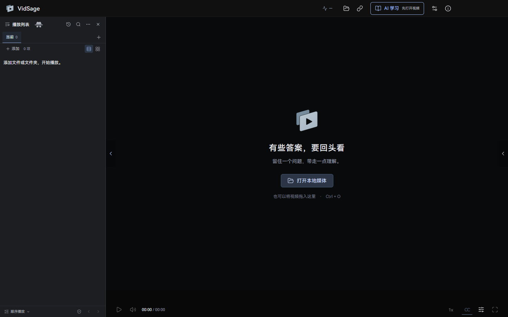
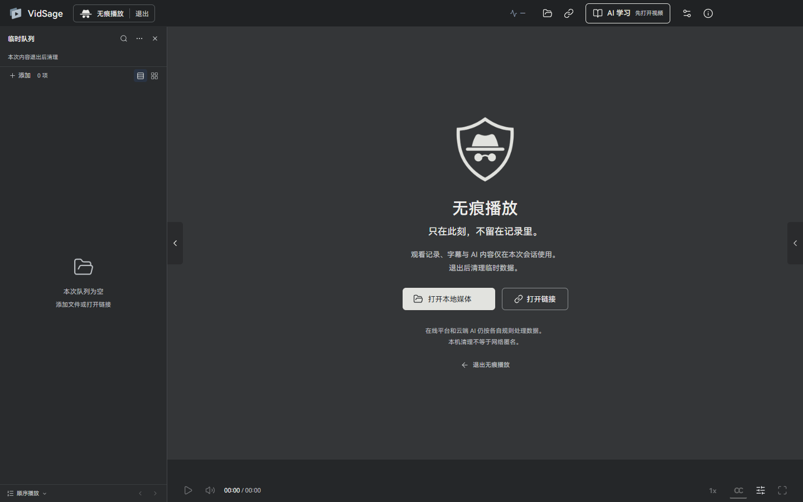
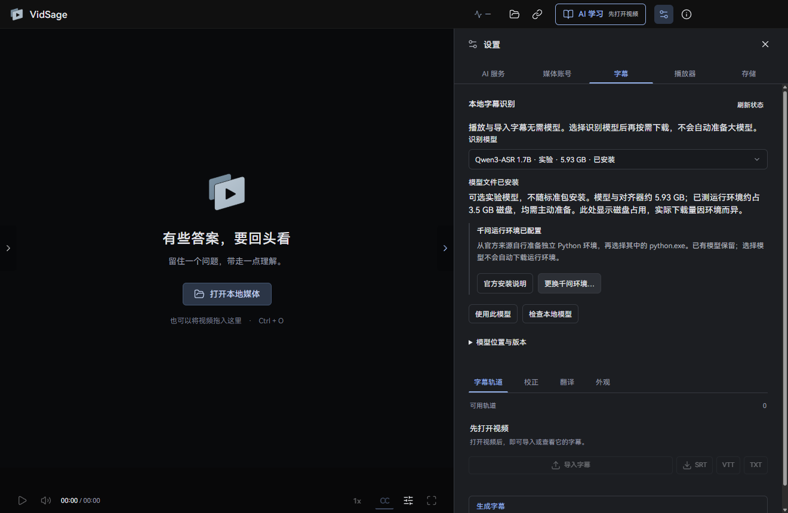

<h1 align="center">VidSage 脉络</h1>

<strong>看视频，也理清思路。</strong> 视频学习播放器，把字幕、笔记与 AI 分析放在视频旁边。

<strong>简体中文</strong> · <a href="README.en.md"><strong>English</strong></a>

  

<a href="docs/GETTING_STARTED.zh-CN.md">开始使用</a> · <a href="docs/HARDWARE.zh-CN.md">硬件与模型</a> · <a href="docs/FEEDBACK.zh-CN.md">反馈问题</a> · <a href="docs/PRIVACY.md">隐私与授权</a>

> **0.1.89 无痕播放测试版。** 从 [GitHub Release](https://github.com/Elviszhuoyu/VidSage-Releases/releases/tag/v0.1.89) 下载完整 Setup、SHA256 和第三方源码材料。安装包未签名，安装前请核对来源。下图来自本版本实际运行界面。

## 为什么做 VidSage

我最初做它，是因为自己在看金融学和一些专业课程时，经常遇到这样的时刻：视频已经往下讲了，我还在想上一个概念到底是什么意思。

有了 AI，我可以把难懂的部分拆开，换个说法问一遍，再回到视频里核对。但网页、插件、笔记之间来回切换，总会打断思路。我想要一个自己用着舒服的桌面工具，让视频、字幕、提问和笔记待在一起。无论是本地保存的课，还是 B站、YouTube 上支持的视频，都能边看边想，把知识慢慢变成自己的理解。

这就是我做 VidSage 的起点。也希望它能让你的学习过程轻松一点。

## 无痕播放：临时观看，退出后清理

从播放列表标题旁的帽子眼镜图标进入。普通队列保留，临时会话使用独立队列、平台账号和 ChatGPT 登录；产品名旁持续显示状态与退出入口。

字幕、分析、问答与临时笔记仅供本次会话使用，不加入普通历史或知识库。退出后先结束会话进程并清理临时数据，再恢复普通播放。石墨灰界面与柔和过渡帮助辨认当前模式，减少动态效果设置也会生效。

无痕模式仍可能写入专用临时目录，不提供磁盘取证不可恢复或网络匿名保证；在线平台及云端 AI 仍按各自规则处理数据。详见[隐私说明](docs/PRIVACY.md)。

## 从观看到理解

- 使用平台已有字幕、导入字幕，或在本机生成字幕。
- 根据字幕分析、提问，点击时间回到原视频核对。
- 留下笔记与分析资料，之后继续阅读和检索。
- 选择 API、ChatGPT 云授权或受支持的本机服务。媒体账号可跳过，本地播放不依赖 AI 账号。

知识拆解区分视频内容解读、概念补充与假设示例，保留解释过程和使用边界。全片问答可继续讨论当前报告中的例子；AI 报告不会成为视频原文证据，回答保留可跳转的字幕引用。

首次打开可跟随六步上手指引，也可跳过。设置分为 AI 服务、媒体账号、字幕、播放器和存储。千问是可选项，模型和运行环境均按需准备，不随标准包下载。

## 我的电脑能用吗

当前面向 **Windows 11 x64、支持 x86-64-v3（含 AVX2）的处理器**。完整包内置 Whisper **base** 模型，本地字幕可以使用 CPU；AMD 显卡或核显用户也可以走 CPU 路径。GPU 加速需要兼容环境，当前候选尚未完成独立 GPU 环境验收。

| 想做的事 | 从这里开始 |
|---|---|
| 看视频、读已有字幕 | 直接打开媒体，无需 AI 账号 |
| 本地生成字幕 | 先用随包 base；small 和 large-v3-turbo 按需下载 |
| AI 分析、问答、翻译 | 配置自己选择的服务，确认费用与内容发送范围 |
| 判断配置是否适合 | 查看[硬件与模型说明](docs/HARDWARE.zh-CN.md)，先试一段短视频 |

为安装和临时解压预留至少 6 GB。模型文件大小不等于内存要求；最低 RAM 和全平台转写速度尚未完成实测，暂不作保证。

## 安装与更新

从[官方下载页](https://github.com/Elviszhuoyu/VidSage-Releases/releases)获取完整 Setup；需要时可核对随页提供的 SHA256。首版未签名，Windows 可能显示未知发布者或安全提示；部分设备策略可能阻止运行。请先核对下载来源，遇到不明或恶意软件提示时停止安装，不要关闭系统防护。

标准包包含播放器、核心、本地字幕运行库和 base 模型，无需开发环境；千问运行环境及其模型另行选择。新版本可在「关于」中检查、下载完整 Setup 并确认安装；从旧版首次升级也可以直接下载运行 Setup。升级和标准卸载默认保留个人资料及模型。

[安装、校验与开始使用 →](docs/GETTING_STARTED.zh-CN.md)

## 隐私与反馈

本地字幕在本机运行。云端分析、问答和翻译会在授权后向所选服务发送字幕与必要上下文。ChatGPT 登录连接云端服务，不是本地模型，也不代表订阅可以调用音频转录接口。

本机保留有限的运行记录，首版没有自动上传。遇到问题，按「关于 → 报告问题 → 预览并检查 → 导出 ZIP」保存诊断包，再决定是否主动提交。**GitHub Issues 对所有人公开；图片和图片元数据不会自动脱敏。**

[如何写清问题、检查材料并提交反馈 →](docs/FEEDBACK.zh-CN.md) · [完整隐私说明](docs/PRIVACY.md)

## 支持作者

如果 VidSage 帮到了你，欢迎请作者喝杯咖啡。金额随心，感谢每一份支持；是否打赏不影响任何功能。

<table>
<tr><td align="center"><strong>微信支付 · WeChat Pay</strong></td><td align="center"><strong>支付宝 · Alipay</strong></td></tr>
<tr><td align="center"></td><td align="center"></td></tr>
</table>

软件内「关于 → 支持作者」也可以打开收款码。打赏不授予二次开发或再分发许可。

## 使用与授权

**原创代码保留权利，二次开发须事先取得作者书面授权。** 正式发布的官方测试包可免费体验。应用源码和开发历史保持私有；GitHub 平台内权利及第三方许可证另行适用。详见[使用与版权声明](COPYRIGHT.md)。

识别、翻译与分析可能出错，尤其是数字和专有名词。重要内容请回到原视频核对；仅处理你有权访问与使用的内容。
