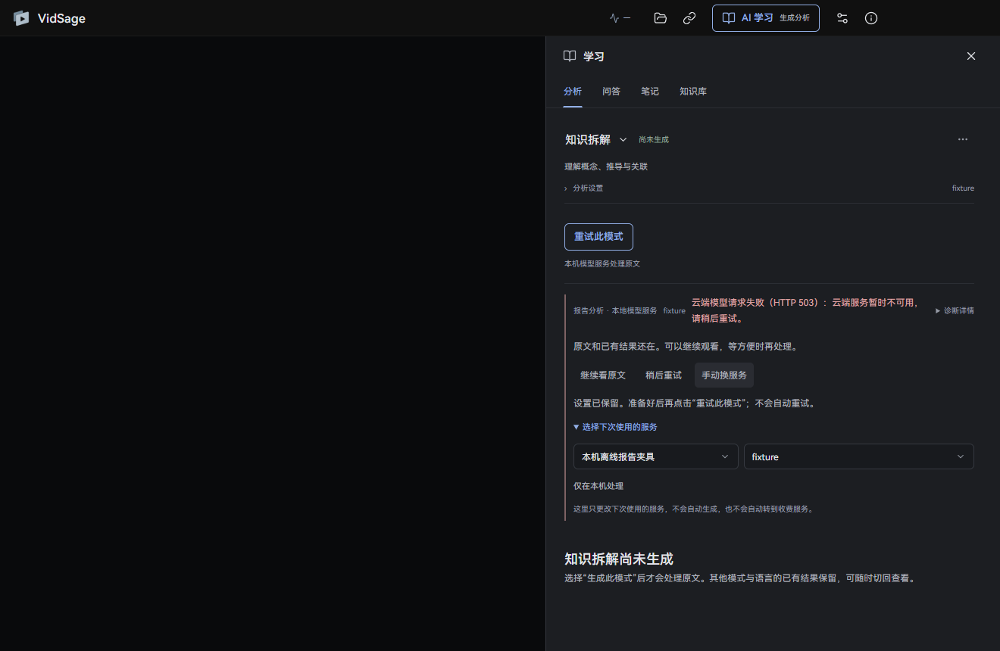

# VidSage 能做什么

这些是当前 Windows 测试版提供的功能。网页油猴版面向浏览器中的 B站视频，两端共用分析与报告能力；安装包无需安装油猴版。

| 用起来是什么样 | 具体功能 |
|---|---|
| 把视频留在眼前 | 本地媒体播放；受支持的 B站、YouTube 公开视频；播放队列、列表/网格、历史、搜索；倍速、音量、全屏、键盘操作、媒体属性 |
| 没字幕也能开始 | 随包 Whisper base 本地转写；CPU 路径；兼容 NVIDIA 环境可加速；其他 Whisper 模型按需准备；千问模型及运行环境单独选择准备 |
| 边看边读 | 平台字幕、SRT/VTT 导入；时间定位、字幕查找与校正；原文/译文/双语显示、字幕外观和轨道导出 |
| 看懂一整段内容 | 省流、详细、长文复盘、时间轴、知识拆解、财经复盘、行动清单；模式分别保存，可沿章节回看；中文/英文分析输出 |
| 从一个问题继续想 | 当前片段、指定章节、所选字幕、视频内容问答；带时间的原文引用；AI 补充与视频原话分开；可追问报告里的例子 |
| 留下以后还会用的东西 | 时间笔记、草稿、分析与问答资料保存；知识库检索、筛选与资料导出 |
| 临时看一段，不混进日常资料 | 播放列表旁进入无痕播放；独立队列与登录环境；字幕、报告和临时笔记随会话退出清理；产品名旁持续显示退出入口 |
| 自己选择怎么处理原文 | Gemini、DeepSeek 等已支持的 API 配置、ChatGPT 订阅授权及兼容本机模型服务；分析与翻译可分别选择；首次发送前确认授权 |
| 失败了也能继续用 | 继续看原文、保留设置稍后重试、手动换服务；失败问题可恢复到输入框；没有自动付费切换 |
| 按需翻译 | 云服务翻译；英语与简体中文离线互译需另行安装模型；本地生成字幕与播放不需要云端 AI 账号 |
| 安装、更新和收拾空间 | 完整安装包；启动自动检查、主界面提示新版；关于页下载安装、取消续传及确认更新；校验通过且条款相同时自动安装重启，条款变化时需向导确认；升级保留资料；卸载可分别选择清理缓存、默认目录模型和个人资料，默认保留；支持已识别旧目录或仅Python缓存残留的原位置重装 |
| 遇到问题能说清楚 | 六步上手指引、服务连接检测、资源状态、可预览后自行导出的诊断包；不会自动上传私人资料 |

无痕播放不等于网络匿名，也不保证磁盘取证不可恢复。在线平台和 AI 服务仍按各自规则处理数据。模型可能遗漏、误译或理解错误，请回到原文核对重要结论。

## 关于云服务和免费额度

Gemini API 免费层的模型可用性、地区、请求频率和每日额度由 Google 决定。软件无法仅从密钥判断计费层级。开发测试中遇到过三类情况：

1. 服务返回 503，暂时无法生成；连接检测通过也可能遇到。
2. 长内容返回不完整，需要缩小处理范围或稍后再试。
3. 请求成功，但内容、分句或引用仍需回到原文核对。

DeepSeek、ChatGPT 订阅及其他服务也有各自额度、网络条件和模型限制，不保证始终可用。软件不会因失败自动切换到收费服务。你可以继续看视频、读原文、记笔记，之后再自行决定是否重试或换服务。

本地字幕与已有资料可继续使用。离线翻译目前支持英中互译，不涵盖所有语言；视频来源仍需符合平台访问条件。
